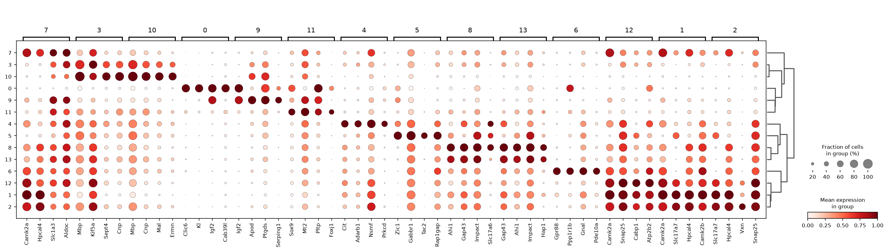
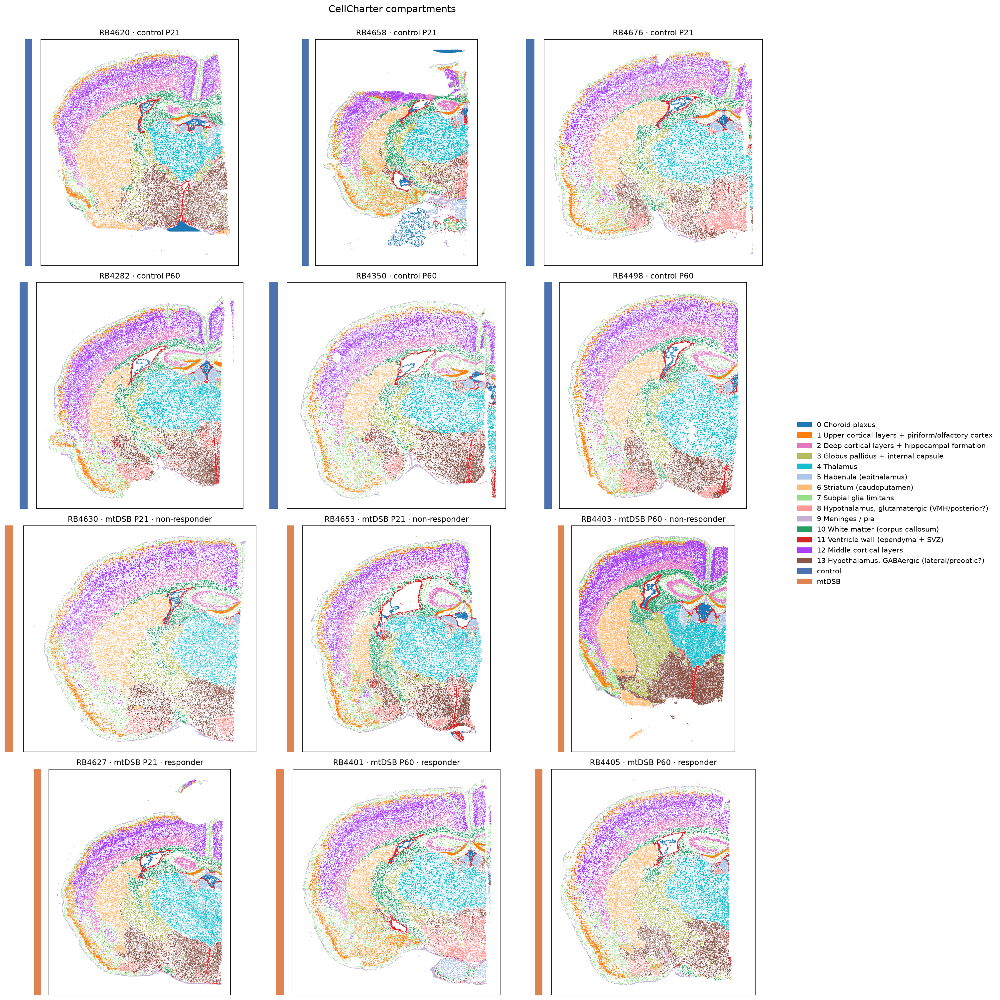
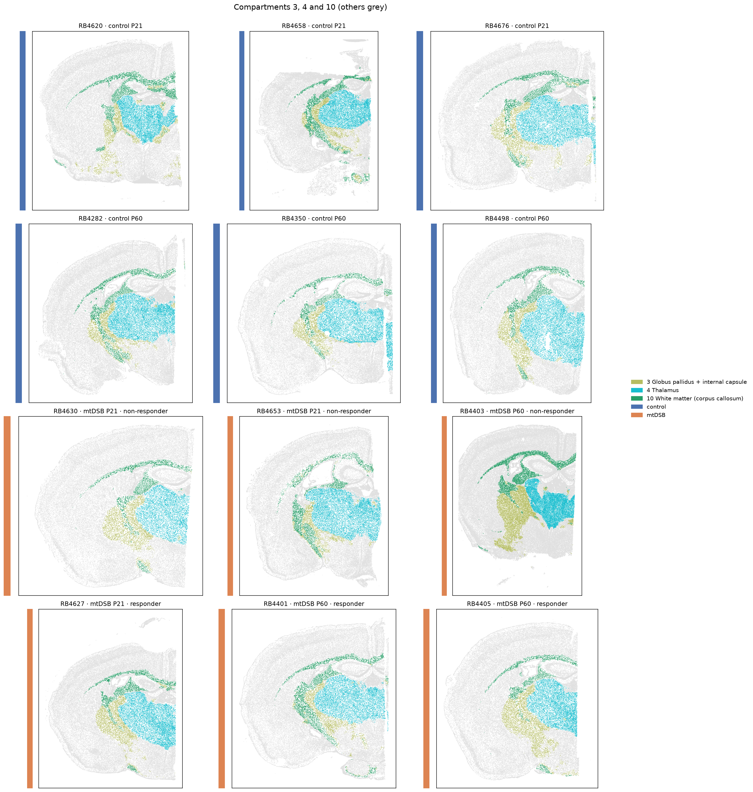
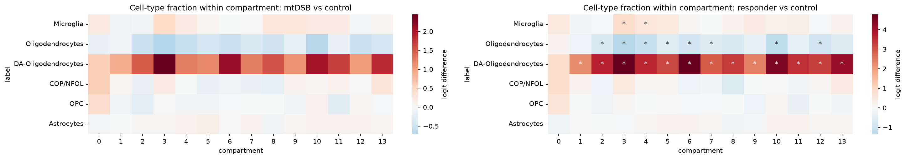
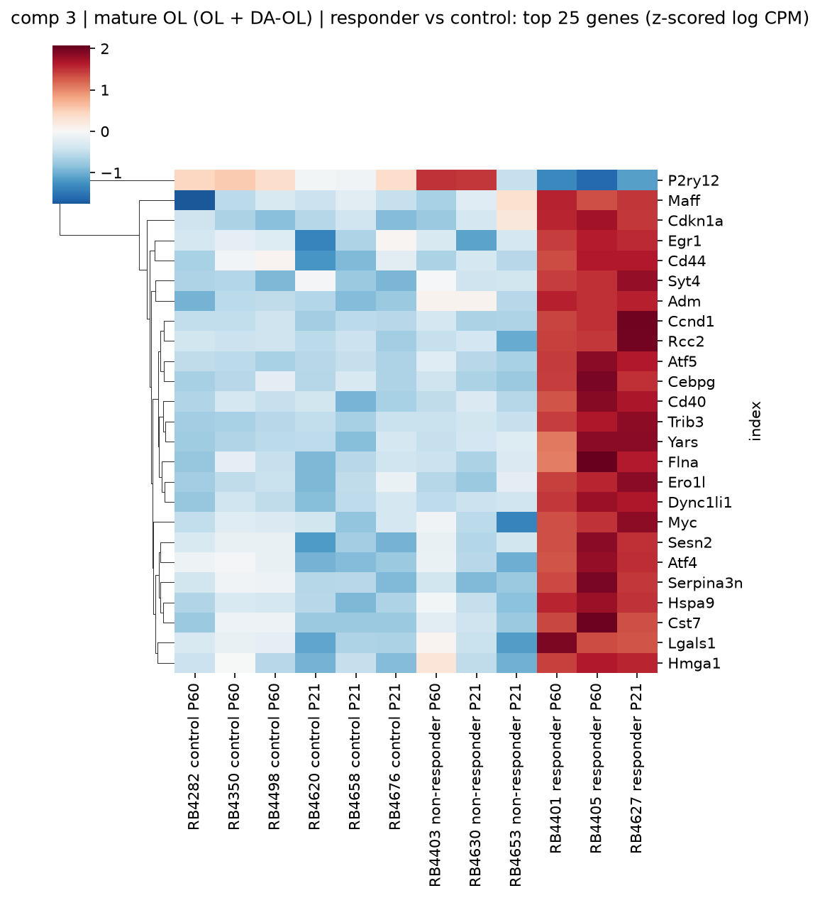
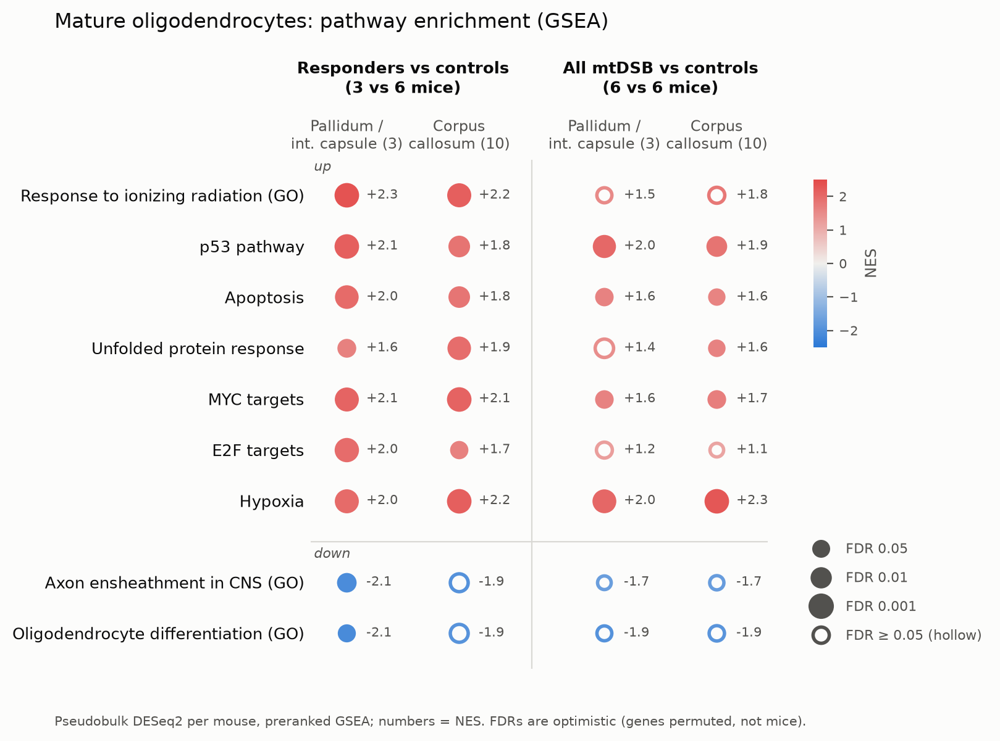
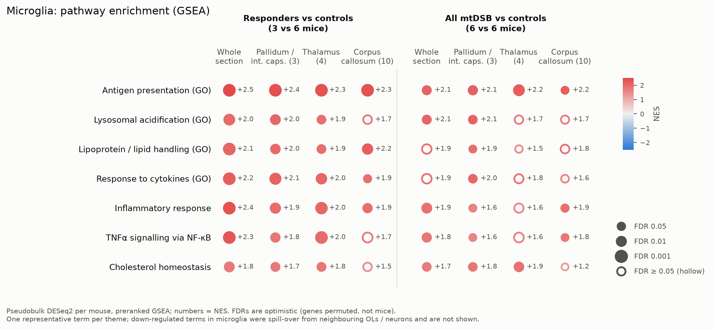
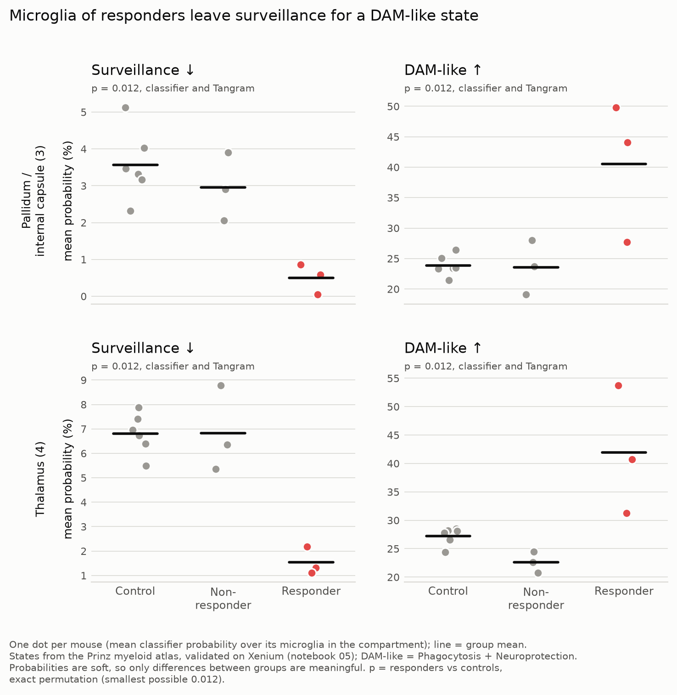
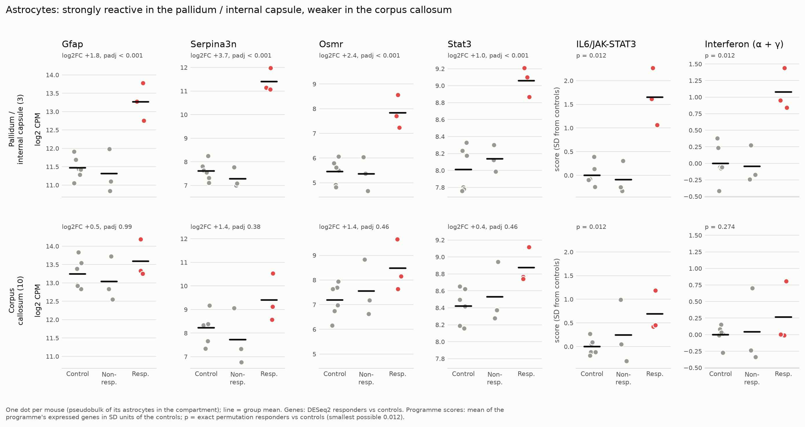

# oligo-mtDSB: CellCharter compartments, oligodendrocyte stress and the microglial response

Xenium 5k spatial transcriptomics of PlpTA:mtPst1 mice (mtDNA double-strand breaks in oligodendrocytes).
12 coronal sections, one per mouse: DOX removal at P21 or P60 × control / mtDSB × 3, collected 42 days after induction.
Report of the CellCharter compartment analysis and of the microglial states transferred from the Marco Prinz myeloid
atlas.

## Summary

- **Only 3 of 6 mtDSB mice respond** (RB4405, RB4401, RB4627).
- **Oligodendrocytes change state, not number**: in responders a stress / DNA-damage programme is switched on and myelin
  genes go down in every CellCharter compartment. The response is strongest in the **thalamus** (compartment 4) and the
  **globus pallidus / internal capsule** (compartment 3), and weaker in the corpus callosum (compartment 10).
- **Microglia become more numerous and activated** where the response is strongest: an MHC-II / DAM-like profile and
  homeostatic genes down. In the globus pallidus / internal capsule and the thalamus, microglia leave the surveillance
  state for a DAM-like state (validated atlas states, confirmed with two label-transfer methods).
- **Astrocytes become reactive** (interferon and IL6/JAK-STAT3 programmes) in compartment 3.
- **Tissue architecture is preserved**: no change in compartment sizes or compartment neighbourhoods, and no repair
  response (OPC fractions unchanged).

## Data and methods

| Step | What | Notebook |
|---|---|---|
| Compartments | CellCharter on scVI (batch = section), 3 neighbourhood layers, k = 14 (AutoK) | `scripts/01_setup_5k_checks.ipynb` |
| Composition, neighbourhoods, DE | one value per mouse; exact permutation tests; pseudobulk DESeq2 per mouse | `scripts/02_compartment_analyses.ipynb` |
| Pathways | GSEA (GO:BP, Hallmark) on the DESeq2 statistic, background = tested panel genes | `scripts/02b_gene_set_enrichment.ipynb` |
| Microglial states | label transfer from the Prinz mouse myeloid atlas: a classifier (primary, validated), with Tangram as a check | `scripts/03_tangram_microglia.ipynb`, `scripts/05_classifier_validation.ipynb`, `scripts/04_microglia_states.ipynb` |

**Statistics.** 
- **mtDSB vs control** (6 vs 6): labels permuted within timepoint (= Xenium slide), min p = 0.005.
- **Responders vs controls** (3 vs 6): 84 relabelings, so the smallest possible p is 0.012. Most responder results below
  sit at this floor.

Primary compartments: 3 and 10.

**Compartments.** 14 domains following brain anatomy, present in all sections; agreement with the RBD regions is
partial (ARI 0.51). Names come from full-panel marker genes, overlap with the RBD regions and cell-type composition (helped by claude). They
are provisional, to be checked.
Optimal compartment number was chosen by AutoK at 14:

| # | Name | Evidence |
|---|---|---|
| 0 | Choroid plexus | Kl, Folr1, Clic6, Cldn2; 69% RBD ventricular system |
| 1 | Upper cortical layers + piriform / olfactory cortex | Slc17a7, Camk2a, Nptxr; RBD olfactory 46%, cortex 35%, dentate gyrus 15% |
| 2 | Deep cortical layers + hippocampal formation | Neurod6, Slc17a7; RBD cortex 80%, hippocampus 16% |
| 3 | **Globus pallidus + internal capsule** (myelinated tracts) | myelin genes with Gad1/2, Slc32a1, Pvalb; RBD pallidum 42%, fibre tracts 37% (corticospinal tract 18%) |
| 4 | Thalamus | Tcf7l2, Prkcd, Slc17a6; RBD thalamus 98% |
| 5 | Habenula (epithalamus) | Tac2, Chrnb4, Pou4f1; RBD epithalamus 64% |
| 6 | Striatum (caudoputamen) | Gpr88, Ppp1r1b, Pde10a; RBD striatum 92% |
| 7 | Subpial glia limitans (cortical / olfactory surface) | astrocytes + endothelium (Slc1a3, Gpr37l1, Mertk, Cxcl14); RBD olfactory 35%, glia limitans 27% |
| 8 | Hypothalamus, glutamatergic (ventromedial / posterior?) | Slc17a6, Adcyap1, Pitx2, Fezf1; RBD hypothalamus 59%, ventral striatum 31% |
| 9 | Meninges / pia | Col1a2, Ptgds, Igf2, Fmod; RBD meningeal border 71% |
| 10 | White matter (corpus callosum) | myelin genes, OLs 68%; RBD fibre tracts 85% |
| 11 | Ventricle wall (ependyma + subventricular zone) | Foxj1, Rsph1, Sox9; neural stem cells 10%; RBD ventricles 74% |
| 12 | Middle cortical layers | Camk2a, Arc, Gabra1; RBD cortex 94% |
| 13 | Hypothalamus, GABAergic (lateral / preoptic?) | Gad1/2, Slc32a1, Pmch, Gal, Ecel1; RBD hypothalamus 70%, ventral striatum 22% |

## Results

### 1. Responders and the oligodendrocyte response
DA-oligodendrocytes (Serpina3n+ stressed OLs) make up < 5% of mature OLs in controls and 31–54% in responders, in
every compartment (p = 0.012 each). Highest share: thalamus (4) 54% and globus pallidus / internal capsule (3) 53%;
lowest: subpial glia limitans (7) 31%, ventricle wall (11) 34%, corpus callosum (10) 37%. Total mature OLs change little (compartment 10: 74% → 72% of cells),
so OLs change state rather than disappear.

Pseudobulk DE in mature OLs (OL + DA-OL) of responders, compartments 3 and 10: all 26 driver genes of the parallel
analysis that are on the panel change in the same direction, and 24 of them at padj < 0.05.
- **Up:** Atf4, Atf5, Ddit3, Trib3, Sesn2, Cdkn1a, Ccnd1, Myc, Mt2, Gstp1, H2-D1, Cd40, Serpina3n.
- **Down:** Mog, Cnp, Cldn11, Mal, Ugt8a, Opalin.
- **GSEA:** response to ionizing radiation / p53, apoptosis, unfolded protein response, MYC/E2F targets and hypoxia up;
  axon ensheathment and OL differentiation down.

### 2. Microglia: more cells and an MHC-II / DAM profile
- **More microglia** in responders in compartment 3 (3.4% → 7.6% of cells) and in the thalamus (2.7% → 4.5%), both
  p = 0.012 (padj 0.08, not statistically significant but it's bacause it cannot go lower with this design - few mice - and the multiple tests that need to be corrected).
- **Activated** (pseudobulk DE, responders, compartment 3; log2 fold change):

  | Direction | Genes |
  |---|---|
  | Up | H2-Aa +7.2, Cst7 +5.9, Cd74 +5.0, Lpl +4.0, Itgax +4.0, Axl +3.3, Cd83 +2.1, Cd68 +1.3, Trem2 +0.8 |
  | Down | P2ry12 −1.9, Tmem119 −1.8, Sall1 −0.9 |

  The same profile appears over the whole section, in the thalamus and, weaker, in the corpus callosum.
- **Pathways:** antigen presentation (MHC-II and MHC-I), lysosomal acidification, lipid handling, cytokine response.
  With all 6 mtDSB mice the same terms appear, weaker (diluted by the non-responders).

- **States from the Prinz atlas.** In responders, microglia in the globus pallidus / internal capsule (3) and the
  thalamus (4) **leave the surveillance (homeostatic) state and move to a DAM-like state** (Phagocytosis +
  Neuroprotection modules).
  - p = 0.012 (the smallest possible with 3 vs 6 mice) for both changes in both compartments; FDR 0.029 with the
    classifier and 0.036 with Tangram. All three responders lie outside the control range.
  - Not supported: a whole-section shift (classifier only), any shift in the corpus callosum, a change in the atlas
    MHC state (mostly MHC-I; the MHC-II increase is seen only in the DE), and any state change with all 6 mtDSB mice
    (nothing survives FDR).

  *Why a classifier and not only Tangram.* Tangram maps atlas cells onto spatial cells by matching whole expression
  profiles. With the Prinz atlas and Xenium microglia, it is a poor state caller:
  - Each Xenium microglia receives a weighted mix of many atlas cells, so its state probabilities are averages: across
    8 states the median top probability is 0.26, and 98% of cells stay below 0.5.
  - The level of these probabilities is set by the composition of the atlas subsample, not by the tissue.
  - Tangram offers no direct way to check how well each state is recovered.
  - The datasets differ a lot (deep scRNA-seq from other disease models vs about 600 transcripts per cell on a 5k panel),
    so similar states blur together.

  A classifier avoids the first two problems and can be validated; Tangram is kept as a check.

  *How the classifier works.*
  - A multinomial logistic regression is trained on 19,788 atlas microglia (at most 3,000 per state) to predict the
    8 atlas states from 541 marker genes that are also on the Xenium panel.
  - Each gene is z-scored within its own dataset, so the model learns "higher or lower than usual in this dataset" and
    is less affected by the platform difference.
  - Strong L2 regularisation spreads the weight over many genes, and balanced class weights keep rare states from being
    ignored.
  - For each Xenium microglia it returns one probability per state, from that cell alone. Probabilities are averaged
    per mouse and compartment and compared with exact permutation tests.
  - Validation (notebook 05): cross-validation grouped by atlas sample, with test cells down-sampled to Xenium depth
    (balanced accuracy 0.54 vs 0.125 by chance; permutation null 0.12–0.13), and a check that each state's probability
    tracks held-out marker genes in the Xenium cells.
  - Only states passing both checks are interpreted: Surveillance, DAM-like (Phagocytosis and Neuroprotection cannot be
    separated at Xenium depth) and MHC.

### 3. Astrocytes
Strongly reactive in compartment 3 of responders: Gfap +1.8, Serpina3n +3.7, Osmr +2.4, Stat3 +1.0 log2FC (all padj <
0.001), with the IL6/JAK-STAT3 and interferon programmes up (p = 0.012 each).

Weaker in the corpus callosum: no single gene is significant there, but the IL6/JAK-STAT3 programme is still up in all
three responders (p = 0.012), and the interferon programme is not (p = 0.27). Gfap is already high in control white
matter, so there is less room to rise.

### 4. What does not change
- Compartment sizes: no difference in any comparison.
- Neighbourhood enrichment between compartments, tested per section: nothing survives correction.
- OPC and committed / newly formed OL fractions (p = 0.13–0.97): no sign of repair.

